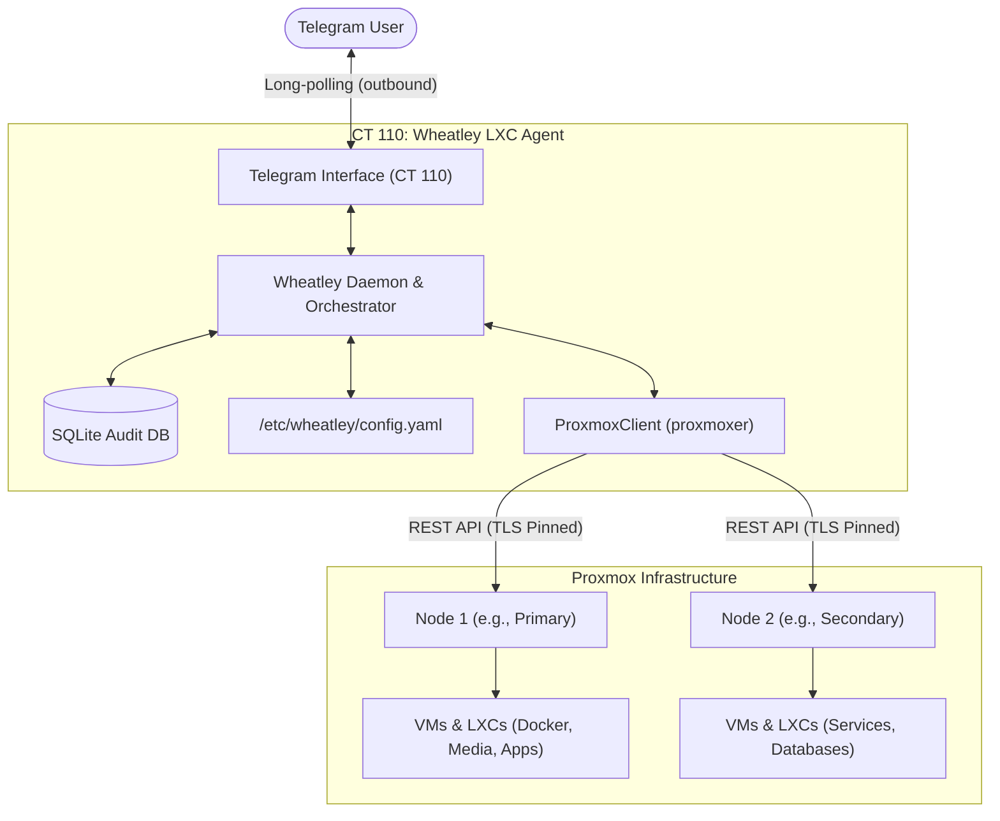

# Wheatley

> **AI Homelab Administration & Monitoring Agent for Proxmox VE**  
> Proactive monitoring, Telegram alerts, and AI-assisted troubleshooting with an **enforced interactive approval gate** for all state changes.

---

## Overview

Wheatley is an autonomous administration agent purpose-built for homelab operators running Proxmox VE. Unlike traditional monitoring dashboards or unconstrained AI tools, Wheatley is built around a **strict safety model**:

- 🛡️ **Interactive Approval Gate:** Safe, read-only diagnostic commands (e.g. `uptime`, `df -h`, `docker logs`) run immediately. **Mutating operations (restarts, stops, edits) strictly require human approval** via Telegram inline buttons (**[Approve]** / **[Deny]**).
- 🔒 **Least Privilege & Native Security:** Runs inside a dedicated, unprivileged Debian LXC container. Connects to Proxmox VE nodes using native `@pve` API tokens with `PVEAuditor` permissions.
- 🌐 **Shareable & Config-Driven:** Zero hardcoded IPs, hostnames, or credentials. Everything lives in `/etc/wheatley/config.yaml` and is backed by environment variable interpolation (`${VAR}`) from `/etc/wheatley/secrets.env`.
- 📊 **Multi-Node Cluster & Standalone Support:** Monitors single standalone nodes or distributed multi-node topologies.
- 🤖 **Bring Your Own LLM (LLM-Agnostic):** Plug in your choice of model: Google Gemini, local Ollama (100% offline private homelab models like `llama3.2`, `qwen2.5`, `mistral`), OpenAI (`gpt-4o-mini`), Groq, DeepSeek, vLLM, or any OpenAI-compatible endpoint. No artificial billing limits or execution pauses.

---

<details>
  <summary><b>Screenshot Examples</b></summary>
  <br>

| Mutating Approval Gate | Command Allowlist Proposal | Information Fetch |
| :---: | :---: | :---: |
|  |  |  |

</details>

---

## Architecture



---

## Quick Start & Installation

### Prerequisites
1. **Proxmox VE Host** (PVE 8.x or 9.x) with root access.
2. **Telegram Bot Token** from [@BotFather](https://t.me/botfather).
3. **Your Numeric Telegram User ID** from [@userinfobot](https://t.me/userinfobot).
4. **LLM Credentials**: Google AI Studio API Key, local Ollama instance, OpenAI API Key, Groq, or any OpenAI-compatible provider.

---

### Step 1: Clone Repository onto Proxmox Host
SSH into your primary Proxmox host and clone the repository:
```bash
git clone https://github.com/loosliashton/wheatley.git /root/wheatley
cd /root/wheatley
chmod +x install/*.sh
```

### Step 2: Configure Primary Proxmox Host
Run the host setup script on your primary Proxmox VE node:
```bash
./install/host-setup.sh --node-index 1
```
This script:
- Creates a dedicated `wheatley@pve` user and `wheatley@pve!bot` API token with `PVEAuditor` read-only privileges on `/`.
- Creates a dedicated `wheatley` Linux user configured with `/usr/local/bin/wheatley-shell` (disabling interactive logins and blocking host command chaining / `pct` & `qm destroy`) and scoped `sudoers` rules for host diagnostics and guest execution.
- Prints your `NODE1_TOKEN_MONITOR` and `NODE1_TLS_FINGERPRINT` entries to save for `/etc/wheatley/secrets.env` (created inside the container in Step 3).

### Step 3: Provision the Dedicated LXC Container
Run the automated LXC installer to provision an unprivileged Debian container (defaults to CTID `110`, 1 vCPU, 1GB RAM, 8GB disk):
```bash
./install/create-lxc.sh --ip 192.168.1.110/24 --gateway 192.168.1.1
```
*Options: `--ctid <id>`, `--hostname <name>`, `--storage <pool>`, `--bridge <bridge>`, `--memory <mb>`.*

`create-lxc.sh` automatically installs Wheatley, configures systemd, seeds configuration templates in `/etc/wheatley`, authorizes the agent SSH key on the host, and installs the host-side `wheatley` CLI wrapper.

*(Optional) If you have additional Proxmox cluster nodes, run `./install/host-setup.sh --node-index 2 --ssh-key "<pubkey>"` on each secondary node using the public key printed by `create-lxc.sh`.*

### Step 4: Configure Secrets & Checks
Enter the container (`pct enter 110`):
*(Note: `create-lxc.sh` automatically seeds `/etc/wheatley/secrets.env`, `config.yaml`, and `checks.yaml` from `/opt/wheatley/`. You do not need to run `cp`; directly edit the pre-created files.)*

1. **Secrets (`/etc/wheatley/secrets.env`):**
   ```bash
   nano /etc/wheatley/secrets.env
   ```
   Add your `TELEGRAM_BOT_TOKEN`, `TELEGRAM_USER_ID`, LLM API key, and the `NODE1_TOKEN_MONITOR` / `NODE1_TLS_FINGERPRINT` values printed by `host-setup.sh`.

2. **Configuration (`/etc/wheatley/config.yaml`):**
   ```bash
   nano /etc/wheatley/config.yaml
   ```
   Update your node `name`, `api_url`, and `ssh.host` IP addresses.

3. **Checks Configuration (`/etc/wheatley/checks.yaml`):**
   Auto-discover checks for running VMs, containers, and services, or edit manually:
   ```bash
   wheatley discover --output /etc/wheatley/checks.yaml
   nano /etc/wheatley/checks.yaml
   ```

4. **Validate:**
   ```bash
   wheatley config validate
   ```

### Step 5: Start the Daemon
Inside `CT 110`, start the systemd daemon:
```bash
systemctl start wheatley
systemctl status wheatley
```
Send `/status` to your bot in Telegram to verify connectivity!

---

## CLI & Telegram Usage

### CLI Commands
Available both inside the LXC container and from the Proxmox host via the convenience wrapper:

```bash
# Auto-discover homelab services & guests across all Proxmox nodes
wheatley discover

# Export recommended checks configuration (refuses to overwrite an existing file;
# add --force / -f to overwrite with a .bak backup, or write to a separate file for review)
wheatley discover --output /etc/wheatley/checks.discovered.yaml

# Validate configuration and secrets
wheatley config validate

# Check engine utilities
wheatley check list
wheatley check run node-health
wheatley check run-all

# Ask Wheatley AI a homelab administration question directly
wheatley ask "How is the cluster doing?"

# View LLM token activity telemetry
wheatley usage

# Inspect the SQLite audit log
wheatley audit

# Inspect the last 25 audit events
wheatley audit -n 25

# Pull the latest version from GitHub and update Wheatley
wheatley update

# Check for updates without applying
wheatley update --check

# Show CLI help
wheatley --help
```

### Telegram Bot Commands
From your authorized Telegram chat:
- **Direct AI Chat** — Message Wheatley directly (e.g. *"Why is the web server slow?"* or *"What guests are running on pve-node-01?"*) for grounded, real-time homelab analysis with tool-assisted diagnosis across any configured LLM.
- `/status` — Aggregates live cluster telemetry (CPU, RAM, uptime, and running/stopped guests across all configured nodes).
- `/checks` — Displays real-time status of all monitored checks and active mute windows.
- `/allowlist` — Lists all active custom allowlist rules, targets, and dates.
- `/allowlist revoke <id>` — Revokes a custom command rule.
- `/usage` — Displays current month & daily LLM token consumption and activity.
- `/investigate <id>` — Triggers automated root-cause diagnosis on any service check.
- `/mute <check_id> [mins]` — Temporarily silences alerts for a service (e.g. `/mute web-app 120`).
- `/unmute <check_id>` — Re-enables alerts for a silenced check.
- `/discover` — Probes nodes & guests to auto-detect active services and container environments.
- `/audit` — Views recent security, webhook, and operational audit events.
- `/update` — Checks for available GitHub updates and proposes self-update with an all-in-one update button (Wheatley also periodically checks for updates in the background and notifies Telegram).
- `/help` — Displays command cheat sheet and operational guidelines.

---

## Documentation

Detailed guides are available in the [`docs/`](docs/) directory:

- [🚀 Quick Start Guide](docs/quickstart.md) — Step-by-step installation on a fresh Proxmox host.
- [📋 Check Types Reference](docs/checks.md) — All built-in checks, options, and plugin extensibility.
- [🛡️ Security & Safety Model](docs/security.md) — Unprivileged LXC, allowlists, and the interactive approval gate.
- [🤖 LLM Provider Setup](docs/llm_providers.md) — Configuration for Gemini, Ollama, OpenAI, Groq, and vLLM.
