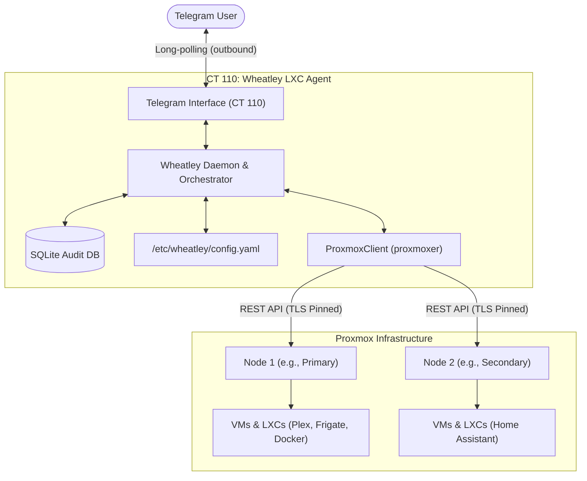

# 🤖 Wheatley

> **AI Homelab Administration & Monitoring Agent for Proxmox VE**  
> Proactive monitoring, Telegram alerts, and AI-assisted troubleshooting with an **enforced interactive approval gate** for all state changes.

---

## 🌟 Overview

Wheatley is an autonomous administration agent purpose-built for homelab operators running Proxmox VE. Unlike traditional monitoring dashboards or unconstrained AI tools, Wheatley is built around a **strict safety model**:

- 🛡️ **Interactive Approval Gate:** Safe, read-only diagnostic commands (e.g. `uptime`, `df -h`, `docker logs`) run immediately. **Mutating operations (restarts, stops, edits) strictly require human approval** via Telegram inline buttons (**[Approve]** / **[Deny]**).
- 🔒 **Least Privilege & Native Security:** Runs inside a dedicated, unprivileged Debian LXC container. Connects to Proxmox VE nodes using native `@pve` API tokens with `PVEAuditor` permissions.
- 🌐 **Shareable & Config-Driven:** Zero hardcoded IPs, hostnames, or credentials. Everything lives in `/etc/wheatley/config.yaml` and is backed by environment variable interpolation (`${VAR}`) from `/etc/wheatley/secrets.env`.
- 📊 **Multi-Node Cluster & Standalone Support:** Monitors single standalone nodes or distributed multi-node topologies.
- 💰 **LLM Budget Guardrails:** Engineered to run on the $10/month Google Developer Program credit (using `gemini-2.5-flash` for triage and `gemini-2.5-pro` for deep investigation) with an automated credit ledger and spending thresholds.

---

## 🏗️ Architecture



---

## 🚀 Quick Start & Installation

### Prerequisites
1. **Proxmox VE Host** (PVE 8.x or 9.x) with root access.
2. **Telegram Bot Token** from [@BotFather](https://t.me/botfather).
3. **Your Numeric Telegram User ID** from [@userinfobot](https://t.me/userinfobot).
4. **Google AI Studio API Key** (or GCP Project linked to Google Developer Program).

---

### Step 1: Clone Repository onto Proxmox Host
SSH into your primary Proxmox host and clone the repository:
```bash
git clone https://github.com/your-username/wheatley.git /root/wheatley
cd /root/wheatley
```

### Step 2: Provision the Dedicated LXC Container
Run the automated LXC installer to provision an unprivileged Debian container (defaults to CTID `110`, 1 vCPU, 1GB RAM, 8GB disk):
```bash
chmod +x install/*.sh
./install/create-lxc.sh --ip 192.168.1.110/24 --gateway 192.168.1.1
```
*Options: `--ctid <id>`, `--hostname <name>`, `--storage <pool>`, `--bridge <bridge>`, `--memory <mb>`.*

### Step 3: Configure Proxmox Nodes
Run the host setup script on **each** Proxmox node you want Wheatley to monitor:
```bash
./install/host-setup.sh
```
This script:
- Creates a native `wheatley@pve` user.
- Generates an API token (`wheatley@pve!bot`) with the `PVEAuditor` role on `/`.
- Prints the exact API token secret and SHA-256 TLS certificate fingerprint.

### Step 4: Populate Secrets
Inside CT 110 (or via `pct enter <ctid>`), create `/etc/wheatley/secrets.env`:
```bash
cp .env.example /etc/wheatley/secrets.env
chmod 600 /etc/wheatley/secrets.env
chown wheatley:wheatley /etc/wheatley/secrets.env
nano /etc/wheatley/secrets.env
```
Fill in:
- `TELEGRAM_BOT_TOKEN` & `TELEGRAM_USER_ID`
- `GEMINI_API_KEY`
- Your Proxmox node tokens and TLS fingerprints.

### Step 5: Configure Nodes & Checks
Copy the generic example configuration to `/etc/wheatley/config.yaml`:
```bash
cp config.example.yaml /etc/wheatley/config.yaml
nano /etc/wheatley/config.yaml
```
Verify that the configuration parses cleanly:
```bash
wheatley config validate
```

### Step 6: Enable & Start the Daemon
Enable the systemd service to start Wheatley on container boot:
```bash
systemctl enable --now wheatley
```

---

## 🛠️ CLI & Telegram Usage

### CLI Commands
Available both inside the LXC container and from the Proxmox host via the convenience wrapper:

```bash
# Validate configuration and secrets
wheatley config validate

# Inspect the SQLite audit log
wheatley audit

# Inspect the last 25 audit events
wheatley audit -n 25

# Show CLI help
wheatley --help
```

### Telegram Bot Commands
From your authorized Telegram chat:
- `/start` — Verifies authentication and registers your session.
- `/status` — Aggregates live cluster telemetry (CPU, RAM, uptime, and running/stopped guests across all configured nodes).

---

## 🗺️ Project Roadmap

- [x] **Phase 1: Foundation**
  - Unprivileged Debian 13 LXC provisioning script (`install/create-lxc.sh`).
  - Configuration loader with Pydantic schema and `${ENV_VAR}` interpolation.
  - SQLite audit logger (`audit_log`, `proposals`, `budget_usage`, `credit_ledger`).
  - Telegram bot adapter with user whitelisting and single-instance atomic file lock.
  - Systemd service daemon.
- [x] **Phase 2: Multi-Node Access & Telemetry**
  - Host security provisioning script (`install/host-setup.sh`).
  - PVE REST API client wrapper with TLS certificate pinning.
  - Live multi-node status aggregation (`/status`).
- [ ] **Phase 2 (Continued): Auto-Discovery**
  - Service fingerprint database (`services.yaml`).
  - Automated guest scanning (`wheatley discover` and `/discover`).
- [ ] **Phase 3: Check Engine & Webhooks**
  - Built-in checks (`node_metrics`, `storage`, `guest_state`, `http`, `docker`).
  - Proxmox `vzdump` backup notification webhook receiver.
- [ ] **Phase 4: Gemini LLM Integration**
  - Function-calling loop with `gemini-2.5-flash` / `gemini-2.5-pro`.
  - Token budget guardrails and $10/mo credit ledger.
- [ ] **Phase 5: Secure Remote Terminal Diagnostics**
  - SSH wrapper with strict command allowlist.
- [ ] **Phase 6: Interactive Approval Gate for Mutations**
  - Cryptographic action hashing, 15-minute expiry, snapshot-before-change prompt.
- [ ] **Phase 7: Cloud Run Watchdog**
  - Dead-man's switch heartbeat on GCP Cloud Run + Cloud Scheduler.

---

## 📄 License
MIT License. Built for the homelab community.
